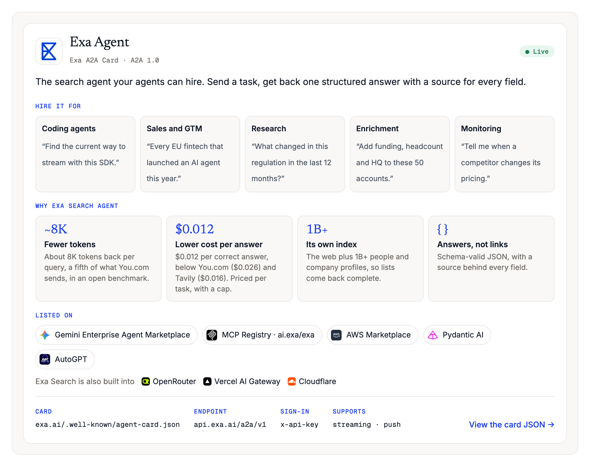
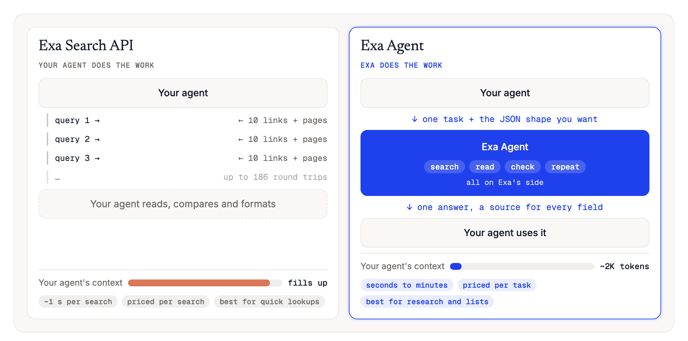
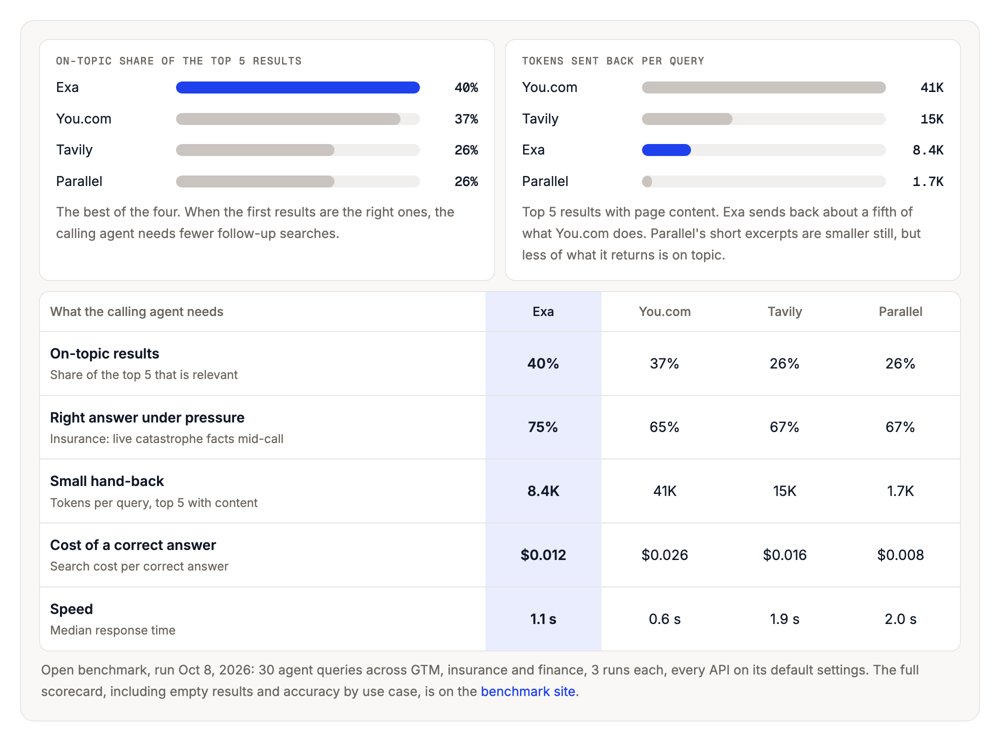
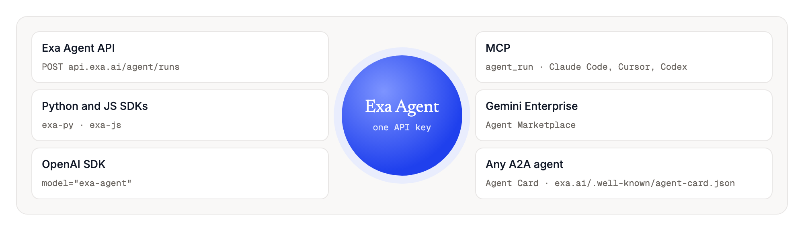

# Exa Agent: the search agent your agents can hire

**Google answered people's queries. Exa takes agents' assignments.**

Your agent sends Exa a task in plain language, plus the JSON shape it wants back. Exa does the searching and reading on its side, then returns one structured answer with a source behind every field. Any agent that speaks A2A, the open agent-to-agent standard, can find Exa through its Agent Card and hire it directly.

**Read the full writeup → https://psinglap.github.io/Exa-Search-Agent-A2A/**

> Example launch post by Pallavi Singla, showing how Exa could position agent-to-agent search for developers. It is not written, reviewed or endorsed by Exa. The A2A Agent Card and the `/a2a/v1` endpoint are a mock-up of what a launch would look like; they are not live. The Exa Agent API, SDKs and MCP tool shown here are real.

---

## The Exa A2A Card

This is what other agents read before they hire Exa: what it's for, why it's different, where it's listed, and how to connect.



## Search API or Exa Agent?

Both run on the same Exa index. The difference is who does the work. With the Search API, your agent gets the ingredients and cooks. With Exa Agent, it gets the finished dish.



## Why Exa fits agent-to-agent

Results from an [open, rerunnable benchmark](https://psinglap.github.io/websearch-api-eval/) of four search APIs: 30 agent tasks across GTM, insurance and finance, three runs each, run on Oct 8, 2026.



- **Most on-topic results:** 40% of Exa's top 5 were relevant, the best of the four, so the calling agent needs fewer follow-up searches.
- **Right answer under pressure:** 75% on live insurance questions asked mid-call, also the best of the four.
- **Fewer tokens:** about 8.4K tokens per query, a fifth of what You.com sends back.
- **Lower cost per correct answer:** $0.012, below You.com ($0.026) and Tavily ($0.016).

Parallel sends back fewer tokens (about 1.7K) and costs less per correct answer ($0.008). You.com is faster (0.6 s median). The full scorecard is on the [benchmark site](https://psinglap.github.io/websearch-api-eval/).

## Why agent-to-agent, and why now

Until recently, an agent that needed something it couldn't do itself had one option: call a tool and do the rest of the work on its own. A2A changes that. Agents from different companies can find each other, hand over a task and get a result back.

Google chose Exa. When Google opened the Gemini Enterprise Agent Marketplace in April 2026, Exa Agent was a launch partner, and Google is also bringing Exa's search into Gemini grounding, which is in private preview ([Exa + Google Cloud](https://exa.ai/blog/exa-google-cloud)). Any company's Gemini agent can hire Exa today.

## Where to find it



## How to call it

**Python SDK** (`pip install exa-py`)

```python
from exa_py import Exa

exa = Exa()  # reads EXA_API_KEY
run = exa.agent.runs.create(
    query="EU fintechs that launched an AI agent in 2026",
    effort="medium",
    output_schema={"type": "object", "properties": {"companies": {"type": "array"}}},
)
run = exa.agent.runs.poll_until_finished(run.id, poll_interval=4000)
print(run.output.structured)   # your JSON
print(run.output.grounding)    # a source for each field
```

**OpenAI SDK**: point it at Exa and set `model="exa-agent"`.

```python
from openai import OpenAI
client = OpenAI(base_url="https://api.exa.ai", api_key=EXA_API_KEY)
response = client.responses.create(model="exa-agent", input="Top 5 AI startups founded in 2025, with funding", reasoning={"effort": "medium"})
print(response.output_text)
```

**MCP** (Claude Code, Cursor, Codex): add `https://mcp.exa.ai/mcp?tools=web_search_exa,agent_run`. Your agent gets an `agent_run` tool.

**A2A (mock-up)**: read `exa.ai/.well-known/agent-card.json`, then send a `SendMessage` task to the endpoint listed on the card. See the [example card JSON](exa-agent-card.example.json).

Pricing is per task: $0.012 at `minimal` effort, up to $1.00 at `xhigh`, with a spending cap you set ([Agent API docs](https://exa.ai/docs/reference/agent-api/overview)).

## What's in this repo

| Path | What it is |
|---|---|
| `index.html` | The writeup, published at https://psinglap.github.io/Exa-Search-Agent-A2A/ |
| `exa-agent-card.example.json` | An example A2A Agent Card for Exa Agent, using A2A v1.0 field names (mock-up) |
| `img/` | The charts above, captured from the page |
| `logos/` | Company logos used on the page |
| `build/build_post.py` | Rebuilds `index.html`. Run `python3 build/build_post.py` |

## Sources

- Customer stories: [Exa case studies](https://exa.ai/customers)
- Product and pricing: [Exa Agent API](https://exa.ai/docs/reference/agent-api/overview), [Exa MCP server](https://github.com/exa-labs/exa-mcp-server), [Exa changelog](https://exa.ai/docs/changelog)
- Google marketplace: [Exa + Google Cloud](https://exa.ai/blog/exa-google-cloud), [Publishing agents in Gemini Enterprise](https://cloud.google.com/blog/topics/developers-practitioners/publish-agents-in-gemini-enterprise-and-google-cloud-marketplace)
- A2A: [A2A specification](https://a2a-protocol.org/latest/specification/)
- Benchmark: [Web Search API evaluation](https://psinglap.github.io/websearch-api-eval/) ([repo](https://github.com/psinglap/websearch-api-eval))

Example writeup by [Pallavi Singla](https://github.com/psinglap). Not affiliated with or endorsed by Exa.
